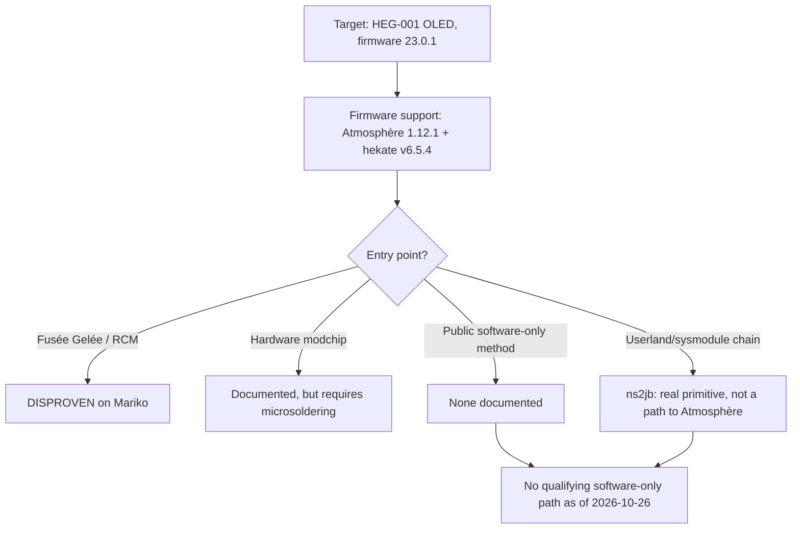

# Switch OLED Potential Jailbreak & USB Tool

A source-backed investigation into a potential software-only Atmosphère jailbreak for the Nintendo Switch OLED, plus a read-only macOS USB inspection tool.

> **Research snapshot: 2026-10-26. Potential, not achieved.** No publicly documented, reproducible software-only path to Atmosphère was found for an unmodified Switch OLED (Mariko) on firmware 23.0.1. Atmosphère 1.12.1 and hekate v6.5.4 support the firmware, but firmware compatibility is not an entry point. The documented route requires a hardware modchip, which is outside this project's software-only scope.

This repository does not contain a working exploit, a payload, or a flashing tool. It is a potential-jailbreak research ledger and a read-only USB inspection tool.

## The short version

| Question | Finding | Status |
|---|---|---|
| Does Atmosphère support firmware 23.0.1? | Yes, Atmosphère 1.12.1. | **VERIFIED** |
| Does hekate support firmware 23.0.1? | Yes, hekate v6.5.4. | **VERIFIED** |
| Does an unmodified OLED have a documented software-only entry point to Atmosphère? | None found in the reviewed public sources. | **DISPROVEN** within the reviewed documentation |
| Does Fusée Gelée apply to the OLED? | No. The OLED uses patched Mariko hardware. | **DISPROVEN** |
| Is a modchip the documented route? | Yes, but it is a hardware modification and out of scope. | **VERIFIED** |
| Is there a real software-only userland/sysmodule chain? | Yes: `ns2jb`, but it is Switch 2-packaged, Switch 1-unpackaged, and not a path to Atmosphère. | **PARTIALLY VERIFIED** |
| Could an undisclosed software-only method exist? | Cannot be established from public sources. | **UNKNOWN** |
| Is this exact console an OLED on 23.0.1? | User-reported; not independently observed. | **UNVERIFIED** |

The important distinction is between **firmware support** and **entry-point support**. Atmosphère and hekate can support the firmware's system modules and boot process, while the console's bootROM still refuses to run an unsigned payload.



This is an **absence-of-documented-method** finding, not proof that no undisclosed exploit exists. See [`research/known-limitations.md`](research/known-limitations.md) and the evidence ledger for the exact scope.

## What we checked

The detailed matrix is in [`docs/ENTRY-POINTS.md`](docs/ENTRY-POINTS.md) and [`research/entry-points.json`](research/entry-points.json). In summary:

| Surface | Result |
|---|---|
| BootROM / RCM | Fusée Gelée is patched on Mariko; RCM enumeration does not accept a payload. |
| Recovery / Maintenance mode | Documented functions are update and initialize/format; no code execution. |
| Browser / WebKit applets | Historical PegaSwitch targets 1.0.0/Fake News; no public 23.0.1 chain found. |
| PTP / MTP USB album mode | Identity and media transfer only; no shell, ADB, or general-purpose control. |
| Local wireless (`ldn`) | CVE-2026-82079 is fixed in 23.0.0; the target is reported on 23.0.1. |
| Bluetooth | Public stack overflows are fixed before 23.0.1; no public current chain found. |
| Game saves / cartridges | No public code-execution chain on 23.0.1 found; save editing is not code execution. |
| System services / sysmodules | `ns2jb` is a real userland/sysmodule chain, but not a path to Atmosphère. |
| Kernel / TrustZone | No public 23.0.1 chain found; a kernel primitive alone is not a boot path. |
| Hardware modchip | Documented route, but not software-only and out of scope. |

## The closest public lead: `ns2jb`

`ns2jb` is the most important recent lead because it is a **real software-only userland/sysmodule chain** on a current firmware, not a hypothetical. It is also easy to misread:

- It is packaged for **Switch 2** system software 23.0.1.
- It runs native code as ordinary sysmodules and as the built-in `fs` sysmodule.
- It does **not** provide kernel access, bootROM access, CFW, or persistence.
- The author says the chain was **also tested on Switch 1**, but it is not packaged for Switch 1, the model and firmware are not stated, and the author says it would not provide modchip-level capability.
- No OLED/Mariko 23.0.1 test is documented.

It is a lead worth following, not a method to run. See E-021, E-022, E-032, and E-034 in [`research/evidence-ledger.json`](research/evidence-ledger.json).

## What this repository is

- A potential-jailbreak investigation: a reproducible, source-backed entry-point and compatibility analysis.
- An evidence ledger with explicit statuses, confidence, scope, and limitations.
- A record of what would change the conclusion, including the `ns2jb` Switch 1 lead.
- A macOS-first, read-only USB inspection CLI.
- An opt-in PTP identity probe that sends only the documented `GetDeviceInfo` operation.

## What this repository is not

- Not a working jailbreak, exploit chain, payload injector, or firmware flasher.
- Not a modchip installation guide.
- Not a way to bypass the Mariko bootROM.
- Not a claim that PTP output proves a console is unmodified or exploitable.
- Not legal advice. Modifying a console can affect its warranty and Nintendo's service terms.

## Research data

| Record | Purpose |
|---|---|
| [`research/sources.json`](research/sources.json) | Source register with retrieval dates, snapshots, and licenses. |
| [`research/evidence-ledger.json`](research/evidence-ledger.json) | Claims, status, confidence, scope, and limitations. |
| [`research/entry-points.json`](research/entry-points.json) | Detailed surface-by-surface entry-point matrix. |
| [`research/compatibility-matrix.json`](research/compatibility-matrix.json) | Higher-level compatibility record. |
| [`research/known-limitations.md`](research/known-limitations.md) | What the research cannot establish. |
| [`research/CHECKPOINT.md`](research/CHECKPOINT.md) | Resumable project state. |

Every material claim uses one of five labels:

- **VERIFIED** — directly supported by an authoritative or primary source, with no reviewed contradiction.
- **PARTIALLY VERIFIED** — indirect evidence, or evidence that covers a related but not identical case.
- **UNVERIFIED** — plausible or user-reported, but not independently checked.
- **DISPROVEN** — contradicted by an authoritative source or direct evidence.
- **UNKNOWN** — insufficient evidence; neither supported nor contradicted.

The source register records retrieval dates and snapshots. Run the research validator after editing the JSON:

```bash
python3 scripts/validate_research.py
```

## USB tool: read-only inspection

The USB tool is part of the project. It is useful for observing what a console reports, not for exploiting it.

Requirements: macOS, Python 3.11 or newer, and the built-in `system_profiler` and `ioreg` tools. Enumeration has no third-party dependencies.

```bash
python3 --version

# Environment and repository checks. Does not open any USB device.
PYTHONPATH=src python3 -m switch_usb_probe doctor

# Enumerate every USB device and classify recognizable Switch modes.
PYTHONPATH=src python3 -m switch_usb_probe list

# Machine-readable output. Serials are redacted by default.
PYTHONPATH=src python3 -m switch_usb_probe list --json

# Explain a known USB ID without touching hardware.
PYTHONPATH=src python3 -m switch_usb_probe classify --vid 0x057e --pid 0x201d

# Print the current research conclusion.
PYTHONPATH=src python3 -m switch_usb_probe compat
```

### Optional: PTP identity probe

`ptp-info` is the only command that opens a USB device. It sends only PTP `GetDeviceInfo` (`0x1001`) and never writes data, transfers files, or sends a payload.

```bash
# pyusb is optional and only needed for this command.
python3 -m venv .venv
.venv/bin/python -m pip install -e '.[ptp]'

# Show the plan without opening the console.
.venv/bin/python -m switch_usb_probe ptp-info --dry-run

# Open the device and read DeviceInfo after you have confirmed its identity.
.venv/bin/python -m switch_usb_probe ptp-info --confirm
```

If the device requires `OpenSession` before it answers, the command exits with code `5` and explains the `--allow-session` option. A session is still used only for read-only identity queries and is closed afterward. macOS may hold the PTP interface through `ptpcamerad`; this tool reports a busy device and never kills the daemon automatically.

See [`docs/USB_INTEGRATION.md`](docs/USB_INTEGRATION.md) for the protocol details, privacy rules, and failure modes.

### Exit codes

| Code | Meaning |
|---|---|
| `0` | Success, including a dry run that intentionally did not open a device. |
| `2` | No matching device was found. |
| `3` | Permission denied or the device/interface is busy. |
| `4` | A USB or enumeration operation timed out. |
| `5` | Unsupported input, mode, or missing optional dependency. |
| `130` | Cancelled by the user. |

## Safety boundaries

This project is inspection-first:

- No arbitrary payloads, exploit execution, or RCM payload injection.
- No firmware updates or downgrades.
- No flashing, NAND access, partition changes, or boot-configuration changes.
- No `sudo`, privileged drivers, or macOS security changes.
- No automatic killing of `ptpcamerad` or other system processes.
- No full serial numbers, keys, certificates, NAND dumps, or proprietary firmware in the repository.

The only optional dependency is `pyusb`, installed into a repository-local virtual environment. The project does not require a system-wide install.

## Repository layout

```text
README.md
CONTRIBUTING.md
SECURITY.md
LICENSE
pyproject.toml
opencode.json

docs/
  COMPATIBILITY.md          Compatibility findings and the ns2jb nuance
  ENTRY-POINTS.md           Readable surface-by-surface analysis
  USB_INTEGRATION.md        macOS USB architecture, PTP, privacy, failure modes
  RESEARCH_METHODOLOGY.md   Source rules, status labels, reproduction steps
  SAFETY_AND_RECOVERY.md    Scope, risks, recovery, incident response
  DECISION_LOG.md           Dated project decisions and rationale

research/
  sources.json              Source register (source of truth)
  evidence-ledger.json      Claims, status, confidence, limitations
  entry-points.json         Detailed entry-point matrix
  compatibility-matrix.json Higher-level compatibility record
  known-limitations.md      What this research cannot establish
  CHECKPOINT.md             Resumable project state
  hardware-observations/    Real, redacted observations only

src/switch_usb_probe/       Read-only USB inspection package
scripts/validate_research.py Research data validator
```

Validation and rendering scripts beyond the validator, and the mocked USB test suite, are planned. The research JSON is currently validated with `python3 scripts/validate_research.py`; the CLI has been exercised with `doctor`, `classify`, and `compat`.

## Documentation

- [Entry points](docs/ENTRY-POINTS.md)
- [Compatibility](docs/COMPATIBILITY.md)
- [USB integration](docs/USB_INTEGRATION.md)
- [Research methodology](docs/RESEARCH_METHODOLOGY.md)
- [Safety and recovery](docs/SAFETY_AND_RECOVERY.md)
- [Decision log](docs/DECISION_LOG.md)
- [Known limitations](research/known-limitations.md)
- [Checkpoint](research/CHECKPOINT.md)

## Contributing

Contributions are welcome if they preserve the evidence standard and the read-only boundary. Read [`CONTRIBUTING.md`](CONTRIBUTING.md) before opening a pull request. Security-sensitive reports should follow [`SECURITY.md`](SECURITY.md), not a public issue.

## License

MIT. See [`LICENSE`](LICENSE). Third-party sources are cited, not redistributed; their licenses are recorded in the source register.
