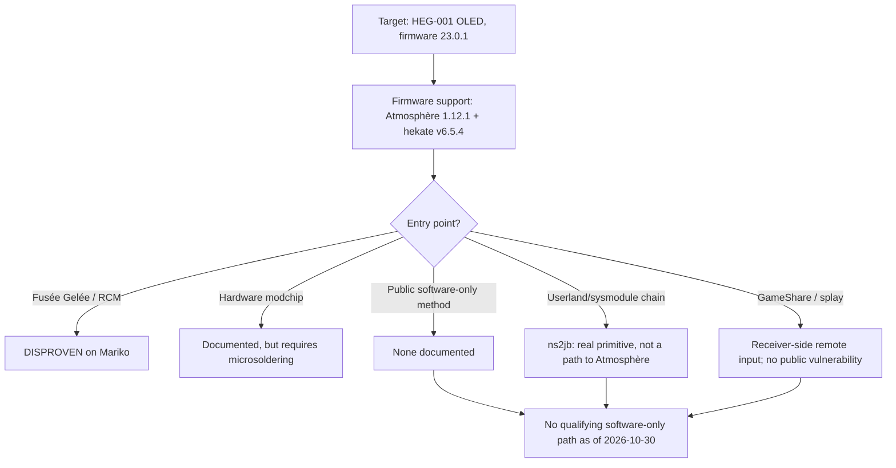

# Switch OLED Potential Jailbreak & USB Tool

A source-backed investigation into a potential software-only Atmosphère jailbreak for the Nintendo Switch OLED, plus a read-only macOS USB inspection tool.

> **Research snapshot: 2026-10-30. Potential, not achieved.** No publicly documented, reproducible software-only path to Atmosphère was found for an unmodified Switch OLED (Mariko) on firmware 23.0.1. Atmosphère 1.12.1 and hekate v6.5.4 support the firmware, but firmware compatibility is not an entry point. The documented route requires a hardware modchip, which is outside this project's software-only scope. The conditional pre-auth LDN direction (`D9`/`H-010`) has completed a passive capture on the target: the console's Dragon Ball FighterZ advertisement and plaintext `NetworkId` header were observed. The owner's local `prod.keys` decrypt that advertisement and confirm security mode 1 (prod), challenge enabled, max 2 participants, and app version 26. A prod-mode host built from those parameters emitted 373 AES-CTR advertisements that decrypted correctly, but the console reported no rooms and the host logged no join. Two repeat runs again produced no join and no room. An independent scan with Location Services saw a hidden ambient BSSID but not the host BSSID, and the same-phy captures contained only host frames. An AP-mode control proved the adapter can transmit at -32 dBm, and a follow-up AP-mode management-frame test put a 20-frame test beacon on the air at -28 dBm in all 12 scans. A monitor-mode control showed that monitor-mode injection does not transmit, so the current host path is blocked by `rtw88_8822bu` monitor-mode TX, not by a console rejection. The AP-mode beacon half works, and a unicast vendor action with a temporary station entry was accepted by the kernel without a netlink error; a broadcast LDN vendor action frame remains blocked by mac80211's station lookup. A real LDN unicast run then sent 568 valid advertisements and 568 null-SSID beacons with the AP BSSID, all accepted by the kernel, but the console was off/away, so reception was not observed. The driver rejects a broadcast-BSSID action frame with `EINVAL`, so only the AP-BSSID variant is available. A supervised rerun made the room `TX10LED` appear on the console, but selecting it produced `2203-0065` immediately; the search screen closed, the console returned to the game normally, and hostapd logged no authentication, association, or station event. The room appearance confirms the advertisement reaches the scan path; that join failed because the hostapd WLAN SSID/security did not match the room's 32-character hexadecimal SSID and LDN RSN IE. A second supervised run used the corrected WLAN parameters: the console authenticated, associated with AID 1, and was marked authorized, then disassociated with `reason_code=8` about one second later and sent no observed `0x88B7` request. The monitor saw a 28-byte null-data frame, not the authentication request, and the AP raw socket saw a 20-byte ethertype `0x0006` frame. The association response included an RSN IE that the `ldn` `MonitorAP` does not send, and the AP control port rejects `0x88B7` with `EINVAL` while the raw authorized-station path transmits it protected with KeyID 0. A third supervised run omitted that association-response RSN IE, enabled raw-frame diagnostics and a local `mon-ldn` pcap, and used the authorized-station raw `0x88B7` response path. The console again authenticated, associated with AID 1, and was marked authorized, then sent one 28-byte null-data frame and disassociated with `reason_code=8` about 1.4 seconds later, before any `0x88B7` request; the pcap contained no console data payload frame. The owner saw `2203-0066` again and the game popup `unable to join the room`, and the console returned to the game normally. Omitting the association-response RSN IE did not change the outcome, so the current hostapd/AP path is negative for `D9`; the parser hypothesis remains untested. The leading remaining host-side difference is that hostapd sends a zero-length beacon SSID while the `ldn` `MonitorAP` sends 32 zero bytes. Further progress needs a materially different AP implementation, a different adapter/driver with working monitor-mode TX, or static analysis of the `ldn` NCA with a key set that covers the 23.0.1 key generation. The `ldn` sysmodule is identified in the owner's local firmware dump, but its content cannot be decrypted because the key file stops below the 23.0.1 key generation. A read-only GameShare/`splay` review on 2026-10-29 found no public `splay`/GameShare vulnerability and no post-20.0.0 `splay` security fix: 23.0.0 changed `splay`'s NPDM and RomFS, while 23.0.1 updated only `sdb`. In the owner's dump, the 76 program NCAs split by key generation `0x07`:1, `0x15`:1, `0x16`:7, `0x17`:67; the only `0x15` program is the Mii editor applet `miiEdit`, which decrypted and verified the local NCA path, while `splay`'s `0x17` program NCA remains encrypted. Its `0x00` meta NCA is readable and its CNMT matches the program NCA. A separate general Wi-Fi/network-stack plan (`D10`, `H-011`/`H-012`) is drafted and gated; Phase 0, Phase 1, Phase 2 Batch 1/2, and Phase 3 are complete. The console associated to both test APs, completed the WPA2 pairwise handshake, obtained a DHCP lease, and queried the connectivity-test hostname; the internet step failed with `2110-3128` because the test AP had no NAT. Phase 2 Batch 1 sent the control and `W-01`–`W-08`; Batch 2 sent the control and `W-09`–`W-14`. Neither batch produced a crash, reboot, hang, or new error. `W-06` (DS Parameter IE length 3) and `W-09` (Vendor IE length 0) showed shorter association lifetimes (7.3/15.4 s and 14.7 s) than their 35.4–35.6 s controls and re-associated; those are behavioral leads, not memory-safety findings. Phase 3 control E-C completed the WPA2 handshake and three group rekeys; Batch 1 sent `E-01`–`E-08` and Batch 2 sent `E-09`–`E-14`, each one frame per association, all accepted, with the station associated at 10 s and lifetimes 35.0–35.5 s. No crash or new error occurred; the zero/invalid-MIC limitation means this is a clean negative for the tested EAPOL fields. Phase 4 control C passed the DHCP/DNS stages and failed at the internet step with `2110-3129`; D-01 (DHCPOFFER option 1 length 0) caused `2110-2963` with no crash and a normal 30.1 s lifetime. The remaining Phase 4 DHCP/DNS cases are blocked by the adapter's intermittent AP data path. No vulnerability has been found.

A WebKit n-day assessment is now set up. The local captive-portal runner and probe are validated on loopback, `CVE-2023-28205` (a no-JIT JavaScriptCore structured-clone use-after-free) is the top public candidate, and a bounded console reachability probe awaits explicit approval. No console probe has been run, and a browser compromise would be stage 1 only; see [`docs/WEBKIT-NDAY-PLAN.md`](docs/WEBKIT-NDAY-PLAN.md).

This repository does not contain a working exploit, a payload, or a flashing tool. It is a potential-jailbreak research ledger and a read-only USB inspection tool.

## The short version

| Question | Finding | Status |
|---|---|---|
| Does Atmosphère support firmware 23.0.1? | Yes, Atmosphère 1.12.1. | **VERIFIED** |
| Does hekate support firmware 23.0.1? | Yes, hekate v6.5.4. | **VERIFIED** |
| Does an unmodified OLED have a documented software-only entry point to Atmosphère? | None found in the reviewed public sources. | **DISPROVEN** within the reviewed documentation |
| Does Fusée Gelée apply to the OLED? | No. The OLED uses patched Mariko hardware. | **DISPROVEN** |
| Is a modchip the documented route? | Yes, but it is a hardware modification and out of scope. | **VERIFIED** |
| Is there a real software-only userland/sysmodule chain? | Yes: `ns2jb`, but it is Switch 2-packaged, Switch 1-unpackaged, and not a path to Atmosphère. | **PARTIALLY VERIFIED** |
| Is there a remote-input surface on the console? | Yes: GameShare runs in the `splay` applet, but hosting requires a Switch 2, no public vulnerability exists, and the local `splay` program NCA is blocked by key generation `0x17`. | **UNKNOWN** |
| Could an undisclosed software-only method exist? | Cannot be established from public sources. | **UNKNOWN** |
| Which link of the chain is missing? | Boot-stage execution (warmboot/package1) on Mariko; stages 1–2 are also absent for Switch 1. | **UNKNOWN** — see [`docs/GAP-ANALYSIS.md`](docs/GAP-ANALYSIS.md) |
| Is this exact console an OLED on 23.0.1, and is it unmodified? | PTP observed 23.0.1 and serial prefix `XTJ`; exact model and no-mod history owner-reported. | **PARTIALLY VERIFIED** |
| Does the OLED enumerate as `057e:201d` and answer PTP `GetDeviceInfo`? | Yes, observed 2026-10-26; 10 operations, no session opened. | **VERIFIED** |

The important distinction is between **firmware support** and **entry-point support**. Atmosphère and hekate can support the firmware's system modules and boot process, while the console's bootROM still refuses to run an unsigned payload.



This is an **absence-of-documented-method** finding, not proof that no undisclosed exploit exists. See [`research/known-limitations.md`](research/known-limitations.md) and the evidence ledger for the exact scope.

## What we checked

The detailed matrix is in [`docs/ENTRY-POINTS.md`](docs/ENTRY-POINTS.md) and [`research/entry-points.json`](research/entry-points.json). In summary:

| Surface | Result |
|---|---|
| BootROM / RCM | Fusée Gelée is patched on Mariko; RCM enumeration does not accept a payload. |
| Recovery / Maintenance mode | Documented functions are update and initialize/format; no code execution. |
| Browser / WebKit applets | The captive-portal applet is reachable and executes local JavaScript; feature detection brackets the engine to Safari 15.4–15.6 with no JIT, WebAssembly, WebGL, or `SharedArrayBuffer`. A 2026-10-30 read-only review identified `CVE-2023-28205` (JavaScriptCore structured-clone use-after-free, no JIT) as the top public candidate. The local portal/probe harness is validated, but no console probe has been run. A browser compromise would be applet-level only. |
| PTP / MTP USB album mode | Observed as `057e:201d`; `GetDeviceInfo` answered without a session. Identity and media transfer only; no shell, ADB, or general-purpose control. |
| Local wireless (`ldn`) | CVE-2026-82079 is fixed in 23.0.0; the target is reported on 23.0.1. A conditional pre-auth test (`H-010`) has completed a passive capture, and the owner's local `prod.keys` decrypt the advertisement (security mode 1, challenge enabled, max 2 participants, app version 26). A prod-mode host emitted 373 valid AES-CTR advertisements matching the captured room, but the console reported no rooms and no join; two repeat runs again produced no join and no room. An independent Location Services-enabled scan saw a hidden ambient BSSID but not the host BSSID. An AP-mode control proved the adapter can transmit at -32 dBm, and a follow-up AP-mode management-frame test put a 20-frame test beacon on the air at -28 dBm in all 12 scans. A monitor-mode control showed that monitor-mode injection does not transmit, so the current host path is blocked by `rtw88_8822bu` monitor-mode TX, not by a console rejection. The AP-mode beacon half works, and a unicast vendor action with a temporary station entry was accepted by the kernel without a netlink error; a broadcast LDN vendor action frame remains blocked by mac80211's station lookup. A real LDN unicast run then sent 568 valid advertisements and 568 null-SSID beacons with the AP BSSID, all accepted by the kernel, but the console was off/away, so reception was not observed. The driver rejects a broadcast-BSSID action frame with `EINVAL`, so only the AP-BSSID variant is available. A supervised rerun made the room `TX10LED` appear on the console, but selecting it produced `2203-0065` immediately; the search screen closed, the console returned to the game normally, and hostapd logged no authentication, association, or station event. The room appearance confirms the advertisement reaches the scan path; that join failed because the hostapd WLAN SSID/security did not match the room's 32-character hexadecimal SSID and LDN RSN IE. A second supervised run used the corrected WLAN parameters: the console authenticated, associated with AID 1, and was marked authorized, then disassociated with `reason_code=8` about one second later and sent no observed `0x88B7` request. The monitor saw a 28-byte null-data frame, not the authentication request, and the AP raw socket saw a 20-byte ethertype `0x0006` frame. The association response included an RSN IE that the `ldn` `MonitorAP` does not send, and the AP control port rejects `0x88B7` with `EINVAL` while the raw authorized-station path transmits it protected with KeyID 0. A third supervised run omitted that association-response RSN IE, enabled raw-frame diagnostics and a local `mon-ldn` pcap, and used the authorized-station raw `0x88B7` response path. The console again authenticated, associated with AID 1, and was marked authorized, then sent one 28-byte null-data frame and disassociated with `reason_code=8` about 1.4 seconds later, before any `0x88B7` request; the pcap contained no console data payload frame. The owner saw `2203-0066` again and the game popup `unable to join the room`, and the console returned to the game normally. Omitting the association-response RSN IE did not change the outcome, so the current hostapd/AP path is negative for `D9`; the parser hypothesis remains untested. The leading remaining host-side difference is that hostapd sends a zero-length beacon SSID while the `ldn` `MonitorAP` sends 32 zero bytes. Further progress needs a materially different AP implementation, a different adapter/driver with working monitor-mode TX, or static analysis of the `ldn` NCA with a key set that covers the 23.0.1 key generation. The `ldn` sysmodule has been identified in the owner's local firmware dump, but its content cannot be decrypted because the key file stops below the 23.0.1 key generation. |
| General Wi-Fi / network | Phase 0, Phase 1, Phase 2 Batch 1/2, and Phase 3 complete (`D10`): both test APs reached AP-ENABLED on channel 1; the console associated, completed the WPA2 handshake, obtained DHCP lease 192.168.77.94, and queried ctest.cdn.nintendo.net. Batch 1 sent W-01–W-08 and Batch 2 sent W-09–W-14; neither produced a crash, reboot, hang, or new error. W-06 (7.3/15.4 s) and W-09 (14.7 s) showed shorter association lifetimes than their 35.4–35.6 s controls and re-associated. Phase 3 control completed the handshake and three group rekeys; E-01–E-08 and E-09–E-14 were sent one per association, all accepted, with 35.0–35.5 s lifetimes. Phase 4 control C passed DHCP/DNS and failed at the internet step with 2110-3129; D-01 caused 2110-2963 with no crash and a 30.1 s lifetime. Remaining Phase 4 cases are blocked by the adapter data path. Behavioral leads, not memory-safety findings; a fault would be stage 1–2 at best. |
| Bluetooth | Public stack overflows are fixed before 23.0.1; no public current chain found. |
| Game saves / cartridges | No public code-execution chain on 23.0.1 found; save editing is not code execution. |
| System services / sysmodules | `ns2jb` is a real userland/sysmodule chain, but not a path to Atmosphère. |
| GameShare / `splay` applet | A Switch 2 host can stream to the console over local wireless; the receiver parses host-supplied data. The 2026-10-29 read-only review found no public `splay`/GameShare vulnerability and no post-20.0.0 `splay` security fix. The local `splay` program NCA is blocked by key generation `0x17`, while its meta CNMT is readable; a compromise would be applet-level. |
| Kernel / TrustZone | No public 23.0.1 chain found; a kernel primitive alone is not a boot path. |
| Hardware modchip | Documented route, but not software-only and out of scope. |

## The closest public lead: `ns2jb`

`ns2jb` is the most important recent lead because it is a **real software-only userland/sysmodule chain** on a current firmware, not a hypothetical. It is also easy to misread:

- It is packaged for **Switch 2** system software 23.0.1.
- It runs native code as ordinary sysmodules and as the built-in `fs` sysmodule.
- It does **not** provide kernel access, bootROM access, CFW, or persistence.
- The author says the chain was **also tested on Switch 1**, but it is not packaged for Switch 1, the model and firmware are not stated, and the author says it would not provide modchip-level capability.
- No OLED/Mariko 23.0.1 test is documented.

It is a lead worth following, not a method to run. See E-021, E-022, E-032, and E-034 in [`research/evidence-ledger.json`](research/evidence-ledger.json).

## WebKit n-day setup (2026-10-30)

The captive-portal applet is the only browser surface the project can reach without modifying the console. The 2026-10-26 fingerprint bracketed it to the Safari 15.4–15.6 era and found no JIT. A 2026-10-30 read-only review identified `CVE-2023-28205` as the top no-JIT candidate: a JavaScriptCore `SerializedScriptValue`/`CloneDeserializer` use-after-free reachable through `postMessage`, with a public MIT-licensed PoC written against WebKit-613.1.17.1. The local runner (`scripts/webkit_portal.py`) and probe (`scripts/webkit_probe.html`) are validated on loopback. The console reachability probe and any PoC load require explicit approval, and even a successful browser compromise would be stage 1 and would not reach Atmosphère. See [`docs/WEBKIT-NDAY-PLAN.md`](docs/WEBKIT-NDAY-PLAN.md).

## What this repository is

- A potential-jailbreak investigation: a reproducible, source-backed entry-point and compatibility analysis.
- An evidence ledger with explicit statuses, confidence, scope, and limitations.
- A record of what would change the conclusion, including the `ns2jb` Switch 1 lead.
- A macOS-first, read-only USB inspection CLI.
- An opt-in PTP identity probe that sends only the documented `GetDeviceInfo` operation.

## What this repository is not

- Not a working jailbreak, exploit chain, payload injector, or firmware flasher.
- Not a modchip installation guide.
- Not a way to bypass the Mariko bootROM.
- Not a claim that PTP output proves a console is unmodified or exploitable.
- Not legal advice. Modifying a console can affect its warranty and Nintendo's service terms.

## Research data

| Record | Purpose |
|---|---|
| [`research/sources.json`](research/sources.json) | Source register with retrieval dates, snapshots, and licenses. |
| [`research/evidence-ledger.json`](research/evidence-ledger.json) | Claims, status, confidence, scope, and limitations. |
| [`research/entry-points.json`](research/entry-points.json) | Detailed surface-by-surface entry-point matrix. |
| [`research/compatibility-matrix.json`](research/compatibility-matrix.json) | Higher-level compatibility record. |
| [`research/hypotheses.json`](research/hypotheses.json) | Falsifiable hypotheses with test procedures and kill criteria. |
| [`research/known-limitations.md`](research/known-limitations.md) | What the research cannot establish. |
| [`research/CHECKPOINT.md`](research/CHECKPOINT.md) | Resumable project state. |

Every material claim uses one of five labels:

- **VERIFIED** — directly supported by an authoritative or primary source, with no reviewed contradiction.
- **PARTIALLY VERIFIED** — indirect evidence, or evidence that covers a related but not identical case.
- **UNVERIFIED** — plausible or user-reported, but not independently checked.
- **DISPROVEN** — contradicted by an authoritative source or direct evidence.
- **UNKNOWN** — insufficient evidence; neither supported nor contradicted.

The source register records retrieval dates and snapshots. Run the research validator after editing the JSON:

```bash
python3 scripts/validate_research.py
```

## USB tool: read-only inspection

The USB tool is part of the project. It is useful for observing what a console reports, not for exploiting it.

Requirements: macOS, Python 3.11 or newer, and the built-in `system_profiler` and `ioreg` tools. Enumeration has no third-party dependencies.

```bash
python3 --version

# Environment and repository checks. Does not open any USB device.
PYTHONPATH=src python3 -m switch_usb_probe doctor

# Enumerate every USB device and classify recognizable Switch modes.
PYTHONPATH=src python3 -m switch_usb_probe list

# Machine-readable output. Serials are redacted by default.
PYTHONPATH=src python3 -m switch_usb_probe list --json

# Explain a known USB ID without touching hardware.
PYTHONPATH=src python3 -m switch_usb_probe classify --vid 0x057e --pid 0x201d

# Print the current research conclusion.
PYTHONPATH=src python3 -m switch_usb_probe compat
```

### Optional: PTP identity probe

`ptp-info` is the only command that opens a USB device. It sends only PTP `GetDeviceInfo` (`0x1001`) and never writes data, transfers files, or sends a payload.

```bash
# pyusb is optional and only needed for this command.
python3 -m venv .venv
.venv/bin/python -m pip install -e '.[ptp]'

# Show the plan without opening the console.
.venv/bin/python -m switch_usb_probe ptp-info --dry-run

# Open the device and read DeviceInfo after you have confirmed its identity.
.venv/bin/python -m switch_usb_probe ptp-info --confirm
```

If the device requires `OpenSession` before it answers, the command exits with code `5` and explains the `--allow-session` option. A session is still used only for read-only identity queries and is closed afterward. macOS may hold the PTP interface through `ptpcamerad`; this tool reports a busy device and never kills the daemon automatically.

See [`docs/USB_INTEGRATION.md`](docs/USB_INTEGRATION.md) for the protocol details, privacy rules, and failure modes.

### Exit codes

| Code | Meaning |
|---|---|
| `0` | Success, including a dry run that intentionally did not open a device. |
| `2` | No matching device was found. |
| `3` | Permission denied or the device/interface is busy. |
| `4` | A USB or enumeration operation timed out. |
| `5` | Unsupported input, mode, or missing optional dependency. |
| `130` | Cancelled by the user. |

## Safety boundaries

This project is inspection-first:

- No arbitrary payloads, exploit execution, or RCM payload injection.
- No firmware updates or downgrades.
- No flashing, NAND access, partition changes, or boot-configuration changes.
- No `sudo`, privileged drivers, or macOS security changes.
- No automatic killing of `ptpcamerad` or other system processes.
- No full serial numbers, key material, certificates, NAND dumps, or proprietary firmware in the repository. The owner's local keys and firmware dump are ignored by git and never published.

The only optional dependency is `pyusb`, installed into a repository-local virtual environment. The project does not require a system-wide install.

## Repository layout

```text
README.md
CONTRIBUTING.md
SECURITY.md
LICENSE
pyproject.toml

docs/
  COMPATIBILITY.md          Compatibility findings and the ns2jb nuance
  ENTRY-POINTS.md           Readable surface-by-surface analysis
  GAP-ANALYSIS.md           Stage-by-stage view of the missing chain
  RESEARCH-PLAN.md          Ranked experiments and kill criteria
  LDN-TEST-PLAN.md          Gated LDN passive/active test procedure
  WIFI-NETWORK-TEST-PLAN.md Gated general Wi-Fi/network test matrix
  USB_INTEGRATION.md        macOS USB architecture, PTP, privacy, failure modes
  RESEARCH_METHODOLOGY.md   Source rules, status labels, reproduction steps
  SAFETY_AND_RECOVERY.md    Scope, risks, recovery, incident response
  DECISION_LOG.md           Dated project decisions and rationale

research/
  sources.json              Source register (source of truth)
  evidence-ledger.json      Claims, status, confidence, limitations
  entry-points.json         Detailed entry-point matrix
  compatibility-matrix.json Higher-level compatibility record
  known-limitations.md      What this research cannot establish
  CHECKPOINT.md             Resumable project state
  hardware-observations/    Real, redacted observations only

src/switch_usb_probe/       Read-only USB inspection package
scripts/validate_research.py Research data validator
```

The validator covers the research JSON, including the hypothesis register (`python3 scripts/validate_research.py`). `tests/` covers the capmtp boundary harness with a mocked pipe (`python -m unittest discover -s tests`). A mocked USB test suite for the CLI and a generated Markdown renderer are still planned. The CLI has been exercised with `doctor`, `list`, `classify`, `compat`, and a read-only `ptp-info` identity probe.

## Documentation

- [Entry points](docs/ENTRY-POINTS.md)
- [Gap analysis](docs/GAP-ANALYSIS.md)
- [Research plan](docs/RESEARCH-PLAN.md)
- [LDN test plan](docs/LDN-TEST-PLAN.md)
- [Wi-Fi/network test plan](docs/WIFI-NETWORK-TEST-PLAN.md)
- [WebKit n-day assessment plan](docs/WEBKIT-NDAY-PLAN.md)
- [Compatibility](docs/COMPATIBILITY.md)
- [USB integration](docs/USB_INTEGRATION.md)
- [Research methodology](docs/RESEARCH_METHODOLOGY.md)
- [Safety and recovery](docs/SAFETY_AND_RECOVERY.md)
- [Decision log](docs/DECISION_LOG.md)
- [Known limitations](research/known-limitations.md)
- [Checkpoint](research/CHECKPOINT.md)

## Contributing

Contributions are welcome if they preserve the evidence standard and the read-only boundary. Read [`CONTRIBUTING.md`](CONTRIBUTING.md) before opening a pull request. Security-sensitive reports should follow [`SECURITY.md`](SECURITY.md), not a public issue.

## License

MIT. See [`LICENSE`](LICENSE). Third-party sources are cited, not redistributed; their licenses are recorded in the source register.
