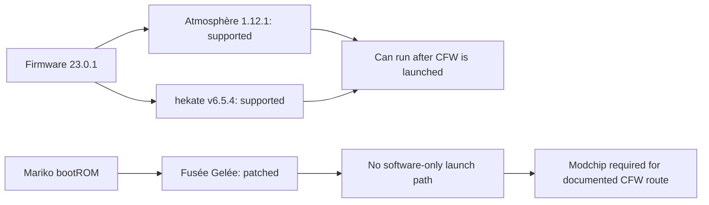

# Compatibility

## Target

| Field | Value | Evidence status |
|---|---|---|
| Model | Nintendo Switch OLED, `HEG-001` | Hardware family **VERIFIED**; this unit owner-confirmed; PTP model string is generic |
| SoC | NVIDIA Tegra X1+ (Mariko), `ODNX10-A1` motherboard | **VERIFIED** |
| Firmware | 23.0.1 | **VERIFIED** via PTP `GetDeviceInfo` on 2026-10-26 |
| Serial prefix | `XTJ` (Japan) | **VERIFIED** via PTP; three characters only |
| Modification history | None reported | Owner-reported; PTP cannot establish it |
| Preferred CFW | Atmosphère | User preference |
| Entry point | No public software-only path to Atmosphère; closest lead is a userland/sysmodule chain (`ns2jb`) | **DISPROVEN** for the target; **PARTIALLY VERIFIED** for the primitive |

The owner manually confirmed the model, firmware, serial prefix, and no-modification history on 2026-10-26. PTP `GetDeviceInfo` on the same date independently observed firmware `23.0.1` and serial prefix `XTJ`, with 10 operations and no session opened. The DeviceInfo model string is generic (`Nintendo Switch`), so the exact `HEG-001` model number and the no-modification history remain owner-reported. PTP does not distinguish OLED from LCD or prove integrity. The compatibility conclusion does not depend on the exact unit being on 23.0.1: the OLED hardware family is the limiting factor.

## Two different questions

A compatibility table can easily mislead if it mixes two independent axes:

1. **Firmware compatibility** — can Atmosphère and hekate operate on this system firmware?
2. **Entry-point compatibility** — is there a way to execute unsigned code on this hardware at all?

The answer here is **yes** to the first and **no documented software-only method** for the second.

Atmosphère's release notes describe support for the firmware's kernel, system modules, and filesystem changes. They do not describe a bootROM exploit. hekate's release notes likewise describe firmware support, not a way to run on an unmodified console.

## Findings

| ID | Claim | Status | Sources |
|---|---|---|---|
| E-001 | Atmosphère 1.12.1 supports firmware 23.0.1. | **VERIFIED** | Atmosphère 1.12.1 release notes; changelog; NH Switch Guide; issue #2883 |
| E-002 | hekate v6.5.4 supports Horizon OS 23.0.1. | **VERIFIED** | hekate v6.5.4 release notes |
| E-003 | The OLED uses Mariko/Tegra X1+ on an ODNX10-A1 board. | **VERIFIED** | Switchbrew hardware; Nintendo support |
| E-004 | CVE-2018-6242 is a Tegra BootROM RCM buffer overflow affecting pre-2016 Tegra processors. | **VERIFIED** | NVD |
| E-005 | Patched/Mariko consoles can enter RCM but cannot receive a payload. | **VERIFIED** | NH Switch Guide, Entering RCM |
| E-006 | The maintained guide routes patched/Mariko consoles to a modchip. | **VERIFIED** | NH Switch Guide, Getting Started and Modchip pages |
| E-007 | A publicly documented, reproducible software-only OLED entry point exists. | **DISPROVEN** within reviewed docs | Absence of any such method; explicit modchip guidance |
| E-008 | The documented route requires a hardware modchip. | **VERIFIED** | NH Switch Guide, Modchip |
| E-009 | This unit is an OLED on 23.0.1, with no modification history reported. | **PARTIALLY VERIFIED** | PTP observed 23.0.1 and serial prefix XTJ; model and mod history owner-reported |
| E-012 | The target OLED enumerates as 0x057e:0x201d and answers PTP GetDeviceInfo. | **VERIFIED** | Hardware observation, 2026-10-26 |
| E-037 | The target console reports firmware 23.0.1 and serial prefix XTJ through PTP, without a session. | **VERIFIED** | `ptp-info --source ioreg --confirm`, 2026-10-26 |
| E-016 | An undisclosed software-only exploit exists. | **UNKNOWN** | Not establishable from public sources |
| E-017 | Firmware support does not imply an entry point. | **VERIFIED** | Derived from the sources above |

The full ledger, including scope and limitations, is in [`research/evidence-ledger.json`](../research/evidence-ledger.json). The machine-readable matrix is [`research/compatibility-matrix.json`](../research/compatibility-matrix.json). The detailed surface-by-surface analysis is in [`ENTRY-POINTS.md`](ENTRY-POINTS.md) and [`research/entry-points.json`](../research/entry-points.json).

## The closest public lead: `ns2jb`

`ns2jb` is the most important recent lead because it is a **real software-only userland/sysmodule chain** on a current firmware, not a hypothetical. It is also easy to misread. The distinctions matter:

| Question | Finding |
|---|---|
| Is `ns2jb` software-only? | **Yes**, on Switch 2 system software 23.0.1. |
| Does it run native code? | **Yes**, as ordinary sysmodules and as the built-in `fs` sysmodule. |
| Does it provide kernel access? | **No.** |
| Does it provide bootROM access? | **No.** |
| Does it install CFW or persistence? | **No.** |
| Is it packaged for Switch 1? | **No.** |
| Is it confirmed on OLED/Mariko 23.0.1? | **No.** The author does not state the Switch 1 model or firmware. |
| Does it change the conclusion for the OLED? | **No.** It is a userland/sysmodule primitive, not a boot chain. |

The author's write-up says the exploit chain was also tested on Switch 1, but it has not been packaged for Switch 1, and the author says it would not provide the capabilities of a modchip. The published repository is Switch 2 only. This is recorded in E-021, E-022, E-032, and E-034. It is a lead worth following, not a method to run on the target.

## 23.0.1-specific checks

| Check | Finding | Status | Evidence |
|---|---|---|---|
| Local-wireless CVE | CVE-2026-82079 affects versions before 23.0.0 and is fixed in 23.0.0; the target is reported on 23.0.1. | **VERIFIED** for the fix; **UNKNOWN** for public exploit availability | E-023, E-035 |
| 23.0.0 service fixes | `bsdsocket` AddrInfo deserialization, `audio` validation, and `ldn` fixes are documented. | **VERIFIED** | E-024 |
| 23.0.1 changes | A stability fix and an `sdb`/SystemVersion update; the security-flaw field is an unfilled wiki placeholder. | **VERIFIED** | E-025 |
| Browser/WebKit | PegaSwitch is historical (1.0.0/Fake News); no public 23.0.1 chain was found. | **UNKNOWN** | E-026, E-028 |
| Bluetooth and local wireless | Public flaws are fixed before or in 23.0.0; no public 23.0.1 chain was found. | **PARTIALLY VERIFIED** | E-029 |
| Recovery mode | Documented functions are update and initialize/format; no unsigned-code execution. | **VERIFIED** for documented behavior | E-030 |
| Mariko boot chain | No unpatched public Mariko software-only boot chain was found. | **PARTIALLY VERIFIED** | E-031 |
| Userland-to-bootROM chain | No public chain connects a userland/sysmodule primitive to kernel or bootROM access on Mariko. | **DISPROVEN** within reviewed docs | E-033 |
| Game saves and cartridges | No public save-data or cartridge code-execution chain was found. | **UNKNOWN** | E-036 |

## Why the OLED is different

The original Switch (Erista, `HAC-001`) used a Tegra X1 bootROM vulnerable to **Fusée Gelée** (`CVE-2018-6242`). An unpatched console can be forced into RCM and receive a payload over USB. That is the path that made early Atmosphère installations possible.

The OLED is a Mariko/Tegra X1+ design. Its bootROM is patched against that vulnerability. The practical consequences are:

- The console can still be placed into RCM.
- The RCM USB device (`0955:7321`) can enumerate.
- A payload cannot be accepted on patched hardware.
- RCM enumeration is therefore **not** evidence that CFW can be launched.

This is why a USB tool must never treat "device detected" as "exploit works". The adapter in this repository is deliberately read-only and does not contain a payload injector.

## The modchip route

The maintained NH Switch Guide documents a hardware modchip as the route for patched and Mariko consoles. A modchip performs CPU voltage glitching to bypass bootROM verification and launch a payload from the SD card. Installation requires microsoldering and carries warranty, safety, and bricking risks.

That route is **out of scope** for this project:

- This repository does not provide installation instructions, firmware, wiring diagrams, or automation.
- It is not a software-only method.
- A hardware modification changes the risk profile and the meaning of "unmodified console".

If you want to pursue that route, use the maintained guide and a reputable installer. Do not treat this repository as a hardware guide.

## What would change this conclusion

The conclusion would need to be revisited if any of the following became available:

- A public, independently reproduced Mariko bootROM or pre-boot software vulnerability that works on 23.0.1.
- A packaged, reproducible Switch 1 version of the `ns2jb` chain, with the model and firmware identified.
- A public chain that connects a userland/sysmodule primitive to kernel or bootROM access on Mariko, with reproducible steps and hardware evidence.
- A documented software-only entry point from a maintained project, with reproducible steps and hardware evidence.
- A correction showing that the target is not Mariko/OLED hardware (for example, a different model or a modified console).
- A change in the documented behavior of RCM or PTP on the target firmware.

A firmware update alone would not create an entry point. A new Atmosphère release alone would not create one either. The missing component is a way to execute unsigned code before Horizon OS starts, or a complete userland-to-boot chain that reaches that point.

## What USB can establish

USB inspection can establish:

- whether a device is present;
- its vendor/product identity;
- whether it matches a known Switch USB mode;
- in opt-in PTP mode, the model, system display version, and serial prefix reported by `GetDeviceInfo`.

USB inspection cannot establish:

- exploitability or the presence of an entry point;
- boot state or CFW access;
- NAND contents;
- that the console is unmodified;
- that a payload would be accepted.

See [`USB_INTEGRATION.md`](USB_INTEGRATION.md) for the implementation and its limits.

## Bottom line

As of **2026-10-26**, the reviewed public documentation supports this conclusion:

> Firmware 23.0.1 is compatible with Atmosphère 1.12.1 and hekate v6.5.4, but an unmodified Switch OLED has no publicly documented, reproducible software-only path to launch Atmosphère. The documented route requires a hardware modchip, which is outside this project's scope. The closest public lead is `ns2jb`, a real software-only userland/sysmodule chain, but it is packaged for Switch 2, is not packaged for Switch 1, and does not provide kernel, bootROM, or CFW access.

This is an absence-of-documented-method finding. It is not proof that no undisclosed exploit exists. See [`research/known-limitations.md`](../research/known-limitations.md).
